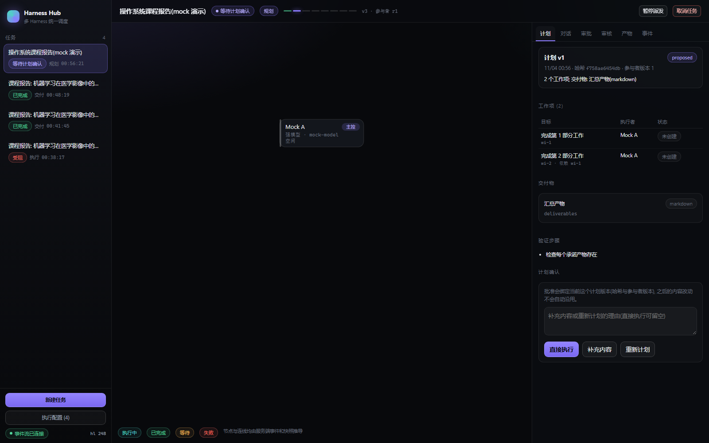
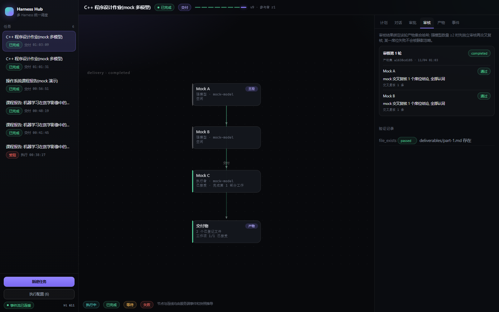
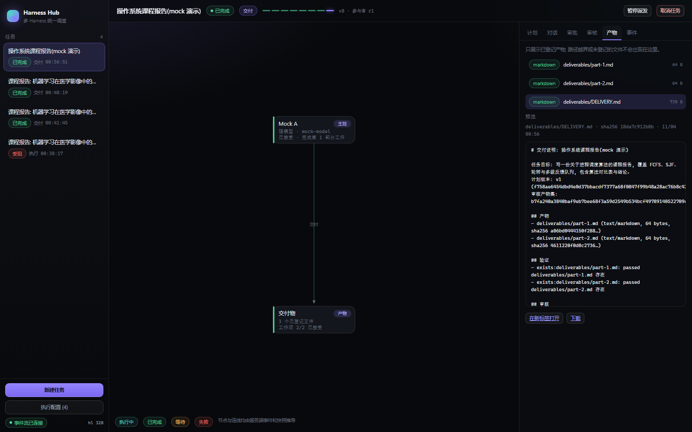
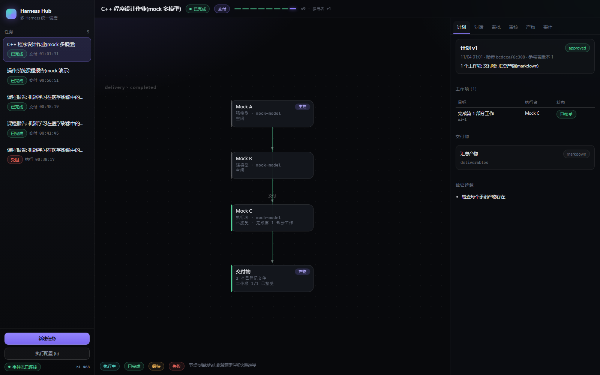
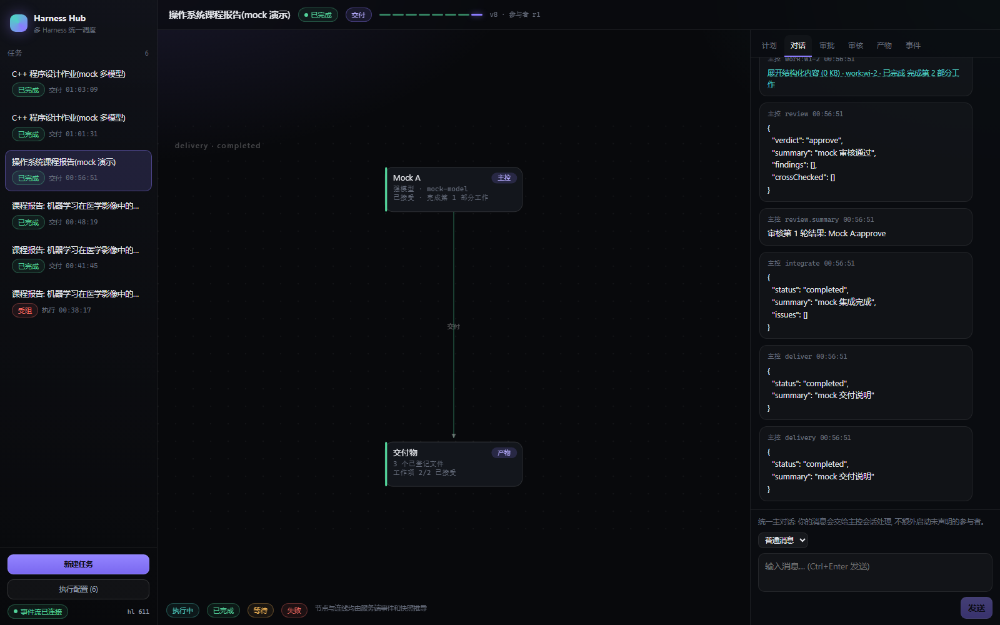

# Harness Hub · 多 Harness 统一调度

在**本机**统一调度多个原生 AI 编码 harness(Codex、Claude Code、DeepSeek Harness, 可扩展 Hermes 等),
由程序状态机负责计划版本、批准门槛、依赖与并发、审核规则、产物验证与故障恢复, 由模型负责规划判断与执行。

- 技术栈: TypeScript + Node.js + React + SQLite(内置 `node:sqlite`), 本地网页 + 本机后端, 无 Electron。
- 只监听 `127.0.0.1`, 不做多用户、不做云端部署。
- 全部文件(代码、依赖、日志、数据库、工作区、凭据副本)都在本目录内。

## 快速开始

前置: Node.js >= 24(`node:sqlite` 需要), 本机已登录至少一个 harness。

```powershell
git clone https://github.com/cunyu999/harness-hub.git
cd harness-hub
npm install
npm run build                     # 编译后端 + 打包前端
npm start                         # 或: node dist/apps/server/src/index.js
```

浏览器打开 <http://127.0.0.1:4310>。

开发模式(两个终端):

```powershell
npm run build:server; npm run dev:server     # 后端 4310
npm run dev:web                              # 前端 4311, 代理 /api 到 4310
```

常用脚本:

| 命令 | 作用 |
| --- | --- |
| `npm run build` | 编译 TS 到 `dist/` 并打包前端到 `apps/web/dist` |
| `npm start` | 启动服务(单实例, 端口 4310) |
| `npm test` | 编译并运行 `tests/` 下的自动化测试 |
| `npm run typecheck` | 后端与共享包类型检查 |
| `npm run typecheck:web` | 前端类型检查 |

环境变量(可选): `HH_PORT`(默认 4310)、`HH_HOST`(默认 127.0.0.1)、`HH_ROOT`(默认本目录)、
`HH_SEED_PROFILES=0` 关闭首次启动的示例执行配置。
演练或测试时可用 `HH_DATA_DIR` / `HH_HOMES_DIR` / `HH_RUNS_DIR` 指向隔离目录, 避免污染正式库与工作区。

## 首次使用

1. 打开左下角「执行配置」, 对每个 harness 点「探针(inspect)」确认可执行文件与协议握手正常。
2. 需要真实运行时, 把该配置设为 `liveEnabled` 并保存; 服务端会把 `~/.codex`、`~/.claude`、`~/.dsh`
   的凭据**复制**到 `.local/homes/<adapter>-<profileId>`(只读复制, 不改动原目录)。
3. 回到主界面「新建任务」: 写标题与目标, 选择强模型(可多选)、主控、执行者。
4. 计划生成后会出现三种选择: **直接执行 / 补充内容 / 重新计划**。批准会绑定
   `planRevisionId + planHash + participantsRevision + expectedTaskVersion`, 计划被改动后旧批准失效。
5. 执行期间左侧协作图实时反映真实会话事件(连接、工具调用、审批、重试、无事件、取消、失败);
   右侧页签可看计划、对话、审批、审核、产物与事件时间线。

## 支持的 harness 与版本

| Harness | 接入方式 | 已验证版本 | 说明 |
| --- | --- | --- | --- |
| Codex | `codex app-server`(JSON-RPC over stdio, v2) | 0.166.0 | 完整原生会话: 线程、回合、工具、审批、中断、恢复 |
| Claude Code | `@anthropic-ai/claude-agent-sdk` 驱动项目内 `claude.exe` | 2.1.317 / SDK 0.3.317 | 完整原生 CLI 会话: 工具、权限回调、续接、中断 |
| DeepSeek Harness | `dsh --profile acp`(ACP over stdio) | 0.2.1-rc.5 | 完整原生 ACP 会话: 提示、工具调用、权限请求、取消、恢复 |
| Mock | 进程内确定性适配器 | 1.0.0 | 仅用于规则与状态机测试, UI 中明确标注 mock |

平台: Windows 11(开发机实测)。Node.js 24.15.0 开发/运行, Codex 与 DSH 通过 `node` 启动,
Claude Code 使用随包分发的 Windows 原生可执行文件。

## 已实现 / 已验证 / 未验证

详细的阶段状态与证据见 `docs/progress.md`、`docs/compatibility.md`、`docs/evidence/`。

- **已验证**: 计划版本与三重绑定、批准门槛、派发依赖与并发上限、写入范围隔离判定、产物登记与哈希、
  程序验证记录、单/多强模型审核(含交叉复核留痕)、交付说明生成、取消语义、重启恢复不自动重跑、
  SSE 快照+增量+心跳+resync、mock 全链路端到端。
- **已验证(真实进程)**: Codex / Claude Code / DSH 的 inspect 握手; Claude Code 与 DSH 的 live 真实回合
  (Claude Code completed, DSH `stopReason=end_turn`)。
- **未验证**: 真实模型下完整任务闭环(课程报告、C++ 程序设计)、真实进程取消与重启恢复的实测、
  Codex live 回合(本轮未授权调用)。

## 设计要点

- **模型判断 vs 程序强制**: 模型只能"提出"计划; 依赖无环、路径安全、验收要求、参与者合法、
  审核席位不得缩减等由程序强制(`packages/core/src/plan.ts`)。
- **事件是唯一真相**: 所有状态变化先落库为带 `seq` 的事件, SSE 以 `seq` 作 `id`, 支持
  `Last-Event-ID`/`after` 与 `resync_required`; UI 不在前端重放业务规则。
- **进程退出 0 ≠ 任务完成**: 完成需产物登记 + 验证通过 + 审核通过 + 交付写入。
- **停止请求 ≠ 已停止**: 只有原生协议确认停止才记 `cancelled`, 否则记 `interrupted`。
- **重启不重跑副作用**: 启动时把活动尝试标为 `interrupted`、未决审批标 `expired`、活动任务置 `paused`,
  由用户确认后再继续。

## 界面

真实事件驱动, 下列截图来自 mock 端的完整任务(同一套状态机与 UI 路径)。

计划确认: 统一计划出来后必须由人选择"直接执行 / 补充内容 / 重新计划", 批准绑定版本哈希。



多强模型协作图 + 交叉审核结果(每个席位独立结论, 并显示交叉复核条数)。



产物只按登记 ID 展示, 支持 Markdown/文本/图片/PDF 内联预览。



单强模型 + 执行者 + 交付物的完成态协作图。



统一主对话: 结构化回合按需折叠, 流式增量在尝试结束后清理。



## 目录

```
apps/server        node:http 服务、SSE、静态资源、私有 home 准备
apps/web           React + Vite 前端(协作图、计划确认、审批、审核、产物、事件)
packages/contracts 实体类型、状态枚举、事件类型、Zod 请求体
packages/storage   node:sqlite 封装、迁移、仓储层
packages/core      计划校验、调度、提示词、事件总线、任务引擎
packages/adapters  codex / claude-code / dsh / mock 适配器与 JSON-RPC 层
tests              node:test 自动化测试
docs               进度、决策(ADR)、兼容性、验收矩阵与证据、界面截图
.local             运行期目录: data/homes/cache/tmp/runs(已 gitignore, 不进仓库)
```

## 仓库不含什么

`.local/`(数据库、工作区、日志、凭据副本)、`node_modules/`、`dist/`、`apps/web/dist/` 均被 `.gitignore`
排除; 仓库只保留源码、测试、文档与截图, 克隆后 `npm install && npm run build` 即可运行。

## 明确不做

- 不实现价格配置、费用计算、节省金额或自动价格路由。
- 不额外调用模型询问进度; 监控状态只来自原生事件、连接与进程检查。
- 不监控本程序之外启动的会话。
- 不自动发布、不自动推送代码。

## 已知限制

- Codex 在 Windows 上的沙箱 `windowsSandbox/readiness` 报 `updateRequired`; 未经管理员准备时命令隔离较弱
  (仍可执行并落盘), 详见 `docs/compatibility.md`。
- `node:sqlite` 在 Node 24 仍为实验 API, 跨大版本升级需回归。
- 真实 harness 的审批请求会原样透传到界面; 若关闭窗口, 待审批请求会在重启后标为 `expired`。
- 第三方许可与再分发要求见 `THIRD-PARTY-NOTICES.md`。
