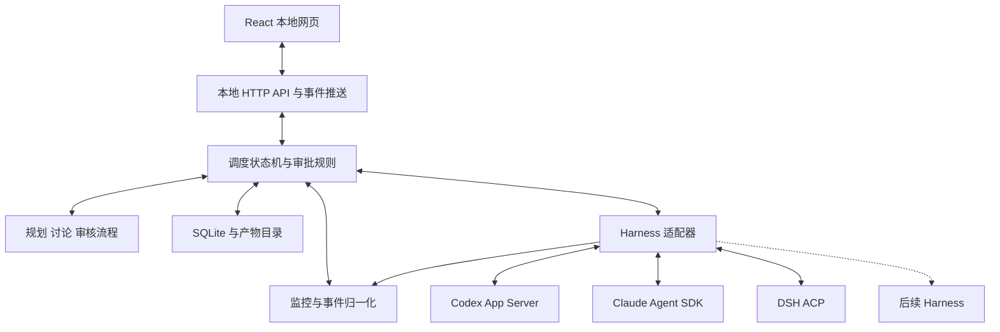

# 多 Harness 统一调度系统: 完整技术路线与实施规范

文档版本: 1.0  
日期: 2026-11-02, Asia/Shanghai  
项目根目录: `D:\1hobby`  
目标读者: 完全没有此前对话上下文的开发者或 AI 编程代理  
状态: 产品需求和主要技术路线已获用户确认; 本文为实施规范, 尚未实现或运行系统.

> 阅读约定: "必须"是验收要求; "默认"是可以由用户在任务中调整的行为; "建议实现"是已选路线下的工程细节, 可在不改变要求时作最小调整. 本文中的接口和字段是本系统拟定的内部契约, 不是声称上游 harness 已提供同名 API.

## 0. 新接手者首先需要知道的事情

### 0.1 项目目标

为用户构建一个个人使用优先、可以在 GitHub 开源的本地程序. 程序统筹多个完整 agent harness, 首批接入 Codex、Claude Code、DeepSeek Harness, 后续可扩展 Hermes 等. 用户希望通过强模型规划与审核、较低成本模型执行细分任务来减少不必要的强模型使用, 同时保留原生工具能力与任务质量.

对用户来说, 这是一个连续的 agent 对话. 多会话只用于资源分工和协作, 用户不应成为各个终端之间的人肉传话者.

### 0.2 已确认的最终决策

| 事项 | 最终决策 |
| --- | --- |
| 运行形态 | Windows 本机后端 + 本地浏览器网页, 第一版不做 Electron |
| 技术组合 | TypeScript + Node.js + React + SQLite |
| 视觉与交互 | 以 raylee-ai/lancer 为主要参考, 抽取适合的展示组件, 后端独立 |
| 首批 harness | Codex、Claude Code、DeepSeek Harness, 不是只允许 3 种 |
| 用户现有付费方式 | Codex 使用订阅; Claude Code 与 DSH 使用第三方 API |
| 接入方式 | 用户先配置各 harness, 程序注册并引用执行配置, 不替用户重建模型 API 网关 |
| 任务参与者 | 用户每次选择主控、其他强模型与执行者; 不擅自增加或更换 |
| 单强模型 | 规划、分派或亲自执行、最终审核, 不强制增加第二个评审者 |
| 多强模型 | 必须有方案讨论, 执行完成后必须有交叉审核 |
| 分歧处理 | 主控处理一般分歧; 影响目标、范围、重大风险或验收的分歧交给用户 |
| 计划确认 | 强模型形成统一计划后, 用户选择直接执行、补充内容或重新计划 |
| 授权方式 | 用户批准计划后在范围内自主执行; 重大变更及高风险操作另行确认 |
| 任务种类 | 通用, 不写死为代码、报告或其他预设模式 |
| 输出格式 | 每次任务决定; 指定格式和模板优先于默认值 |
| 报告默认值 | 没有明确格式和模板时, 计划中提出可编辑 Word; PDF 按需; 不是强制模式 |
| 实时监控 | 覆盖本程序启动和管理的所有强/弱模型会话, 不包括外部自行打开的会话 |
| 成本功能 | 不实现价格配置、费用计算、节省金额或费用排行榜 |
| 资源限制 | 保留并发、轮数、任务数量、重试、超时控制 |
| 持久化 | SQLite 保存结构化状态和事件; 文件系统保存产物及必要日志 |
| 讨论实现 | 首版在状态机内实现有限流程; argue 作为可替代参考, 不是必需依赖 |
| 代表性验收任务 | 课程报告、C++ 程序设计与编写 |
| ROS | 曾作为例子, 已被用户替换为 C++; 不要求首版接 ROS 环境 |
| 文件边界 | 本次开发产生的代码、依赖、缓存、虚拟环境、日志和产物全部在项目根目录内 |

### 0.3 当前授权与后续开发授权

本次用户授权创建技术路线及交接文档, 没有要求立即编写程序. 阅读本文本身不是安装依赖、调用收费模型、修改全局配置或发布 GitHub 的授权.

用户后续明确要求"按本文实现"后, 可以在约定项目目录与范围内自主实施, 不逐文件重复确认. 超出范围、覆盖原始数据、全局安装、外部上传、删除及发布等操作仍应按用户要求单独确认. 不自动提交、push、发布软件或上传用户任务材料.

### 0.4 不可误解为这些产品

- 不是只把多个聊天模型 API 放在一起的聊天客户端.
- 不是固定 3 个终端的启动器, 也不是只展示模拟节点的演示页面.
- 不是用户手工拖节点才能工作的低代码流程编辑器.
- 不通过关闭 Skills、MCP、工具或推理能力来制造更便宜的表象.
- 不默认让 Codex 当主控; 用户的订阅情况不构成自动角色绑定规则.
- 不默认弱模型可以完成所有任务; 主控可以在已选范围内接管难题.
- 不承诺多模型讨论总比单模型正确, 不把一致投票当成事实证明.

## 1. 范围与交付目标

### 1.1 必须包含的 MVP

1. 注册和编辑多个 harness 执行配置; 一个 harness 可对应多份配置.
2. 每次任务选择至少一个强模型席位, 指定其中一个为主控; 可选择零个或多个执行者配置.
3. 一个主对话接收需求、附件、补充、计划确认、审批和最终交付.
4. 单强模型/多强模型两种流程, 自动按本次席位数量选择.
5. 统一计划与版本, 用户批准前不派发实施任务.
6. 有依赖的子任务, 可顺序或并行执行, 有并发及失败控制.
7. 原生 harness 接入、事件流、会话 ID 映射、可用时恢复.
8. 所有受管会话的实时监控, 含主控、讨论者、worker、验证者和审核者.
9. 任务状态、事件、审批、验证、审核和产物持久化.
10. 并行写入隔离、集成后验证、同一产物版本的交叉审核.
11. Lancer 风格 UI, 对话与协作图切换, 可查看详情.
12. 停止、取消、重启核对、失败恢复与明确的未验证说明.
13. 用户约束、目录边界及发布时敏感信息排除.
14. 一个真实课程报告任务和一个真实 C++ 任务的完整验收记录.

### 1.2 首版不做

云端部署、多用户账号、移动客户端、远程 ROS、任意外部终端会话监控、全功能终端模拟器、拖拽流程编辑器、插件市场、向量数据库、长期自学习记忆、自动价格路由、计费系统、任意软件桌面自动化的统一实现.

这些限制不禁止已选 harness 在具体任务中使用其已具备且经授权的浏览器或文档工具. 程序应声明实际支持情况, 不能将尚未接入的能力伪装成可用.

### 1.3 完成标准

三种 harness 实际接入并跑通核心流程, 且测试覆盖主要异常. Mock 仅用于自动化测试与明确标识的演示, 不能替代真实接入验收. 任何未通过的能力必须在界面与交付说明中标记, 不可把部分完成称为整个系统完成.

## 2. 产品流程

### 2.1 注册执行配置

用户已有 harness 配置, 本程序保存启动入口和配置引用, 不要求用户重新输入所有模型账号. 第一版提供表单编辑; 可提供脱敏配置导入/导出, 不自动发现或复制所有个人凭据.

注册流程:

1. 选择 harness 类型并命名, 如 `Codex-主力`、`Claude-执行`、`DSH-执行`.
2. 指定实际入口及受支持的 profile/config 引用, 不让前端提交任意拼接 shell 字符串.
3. 展示可读取的模型、推理设置和能力; 无法确认的字段标记未知.
4. 只读检查与真实模型验证分开. 后者明确会向已配置服务发送测试请求.
5. 形成配置能力报告. 缺少本次任务必需能力时, 不静默改为弱化接口.
6. 保存并发上限和超时偏好. 相同账号的不同配置可以声明共享并发组.

### 2.2 创建任务及计划循环

1. 用户输入需求, 可附课程要求、模板、源码、资料或输出格式.
2. 用户选择强模型席位、主控、执行者池; 可载入自己保存的参与者组合.
3. 后端冻结本次配置快照, 检查席位、能力、入口和文件边界.
4. 进入计划阶段. 此时仅允许必要的只读资料检查与规划; 不创建业务产物或修改目标项目. 程序保存会话记录属于已授权的程序运行数据.
5. 单强模型形成计划; 多强模型先独立提案、交换质询, 由主控整理统一计划.
6. 展示计划卡片: 目标、假设、参与者分工、依赖、修改范围、交付格式、验证方式和未解决问题.
7. 用户必须能选择以下动作:
   - `直接执行`: 批准当前确切版本, 并开始实施.
   - `补充内容`: 保留原计划, 将新要求交给强模型形成新版本, 再次展示.
   - `重新计划`: 根据用户说明重新规划, 新版本仍需批准.
8. 未收到执行批准、收到过期批准、用户只是在讨论计划时, 都不能启动实施任务.

计划形成之前发现关键缺失条件可以提问. 一般技术细节由主控提出合理默认值, 在计划中可见, 不要求用户回答一长串实现问题.

### 2.3 执行与中途补充

执行者只收到自己的任务包与必要资料. 主控可在批准范围内调整细节和处理失败; 涉及目标、参与者、写入范围、交付格式或验收标准的实质变更必须生成新计划版本并让用户决定.

中途用户发送消息应支持明确的语义:

- 问进度: 不改变计划, 优先由已有状态直接展示, 无需额外模型调用.
- 补充约束: 主控判断影响; 暂停受影响任务, 保留无冲突的结果, 展示修订计划.
- 停止: 立即停止新派发并向运行实例发出取消, 不等待主控回复.
- 继续: 在已确认状态基础上继续, 不自动批准未解决审批.

不能声称所有 harness 都支持即时插入消息. 不支持时使用明确的排队或"停止当前轮后继续"交互, 告知用户实际行为.

### 2.4 完成与交付

先集成产物并验证, 再按强模型数量审核, 最后由主控统一交付. 最终答复至少包括产物链接、实际验证、未验证项目和未解决问题. 交付消息不能代替文件实际存在与格式可用的检查.

## 3. 架构与技术选择

### 3.1 结构



强模型通过适配器被调用. 不在调度服务内另开一个未选择的通用 LLM 客户端来做路由、标题、摘要或审核.

### 3.2 建议实现栈

| 部分 | 默认实现 | 理由 |
| --- | --- | --- |
| 语言 | TypeScript, strict | 前后端和内部契约共享类型 |
| 包结构 | npm workspaces | 一份锁文件, 不要求全局 pnpm |
| 后端 | Node.js 24 系列兼容版本 + Fastify | 单进程本地服务, 明确请求边界 |
| 前端 | React + Vite | 适合复用 Lancer React 展示逻辑 |
| 运行时校验 | Zod 或等价 JSON Schema 校验, 全项目选定一种主方式 | 模型输出、请求和持久化输入不能只依赖 TS 类型 |
| 存储 | SQLite, repository 接口封装 | 持久化任务状态、审批与事件 |
| SQLite 驱动 | 优先验证 Node 内置 `node:sqlite`; 不满足锁定版本时评估 `better-sqlite3` | 优先减少额外 native build; 驱动不泄漏到业务层 |
| 前端事件 | SSE + 普通 HTTP 命令 | 服务端推事件, 客户端用 POST 发操作; 首版不需要终端双向字节流 |
| 图形 | React 卡片 + SVG 连线 + 可抽取的 Lancer Light UI | 固定自动布局, 不引入通用画布编辑器 |
| 测试 | Vitest, Playwright, adapter contract fixtures | 核心规则、协议解析、真实 UI 分层验证 |

依赖的确切版本在阶段 P0/P1 核验后锁定, 不写 `latest` 并假定可复现. Node 官方 v24 分支文档在本次检查中将 `node:sqlite` 标为 Release candidate, 不是无条件稳定 API. 必须验证锁定运行时的实际接口与 Windows 可用性, 仅依赖需要的基础 API. Fastify 等具体库属于建议实现, 可在保持接口和最小依赖目标时替换, 需记录原因.

### 3.3 模块责任

| 模块 | 负责 | 不负责 |
| --- | --- | --- |
| contracts | 可序列化实体、事件、请求校验 | Node 子进程、React 组件 |
| orchestrator | 状态迁移、DAG、派发、资源名额、计划门槛 | 直接解析各厂商协议 |
| council | 强模型提案、质询、审核、分歧规则 | 修改用户选定参与者 |
| adapters | 原生会话、事件、取消、权限转译 | 决定任务已通过业务验收 |
| process-manager | 启动归属、进程树、运行锁、退出核对 | 推测模型内部思维 |
| monitor | 存活、连接、活动、异常、归一化状态 | 为看进度额外询问 LLM |
| storage | SQLite 事务、迁移、事件序号、命令幂等 | 自行恢复或重跑外部操作 |
| workspace | 路径校验、worktree、集成、产物登记 | 把 cwd 当作沙箱 |
| verification | 验证命令、结果与证据记录 | 用模型口头承诺替代实际测试 |
| web | 展示和用户操作 | 本地 shell、密钥存储、调度真相 |

### 3.4 拟定目录

以下是未来实现结构, 当前仅创建规划文档.

```text
D:\1hobby\
  START_HERE.md
  SYSTEM_BLUEPRINT.md
  package.json
  package-lock.json
  apps/
    server/src/{api,bootstrap}/
    web/src/{pages,components,features,styles}/
  packages/
    contracts/src/
    core/src/{orchestrator,council,monitor,process,workspace,verification}/
    storage/src/{migrations,repositories}/
    adapters/src/{codex,claude,dsh,testing}/
    ui/src/                     # 如确有复用需要, 避免无意义分包
  vendor/lancer-light-ui/       # 经核查后抽取, 保留许可和来源
  tests/{unit,integration,e2e,fixtures}/
  docs/{decisions,compatibility,acceptance}/
  scripts/                     # 项目内启动、诊断、验证
  .local/
    config/
    auth/                      # 若需要项目内独立认证, 私有且不入 Git
    homes/{codex,claude,dsh}/
    data/{app.sqlite,logs}/
    cache/{npm,playwright,...}/
    tmp/
    toolchains/                # 仅经授权确有必要的项目内运行时
    runs/<task-id>/
      workspaces/
      artifacts/
      evidence/
  .venv/                       # 仅文档或任务工具确需 Python 时创建
```

外部用户可以在自己的项目根目录部署, 不把开发者的 `D:\1hobby` 写死进程序. 使用解析后的 `APP_ROOT` 配置, 本次实例默认指向该目录. 子目录名称是建议, 单根写入原则是必须.

## 4. 核心实体与不可变规则

### 4.1 身份层次

- HarnessAdapter: 一种原生运行器的接入实现, 如 codex.
- ExecutionProfile: 一份用户配置的运行入口与配置引用. 一个适配器可有多份.
- Participant: 本次任务的参与席位, 角色为 strong 或 worker. strong 中恰有一个 lead.
- ManagedSession: 具体受管原生会话. 一个席位可为不同阶段创建不同会话.
- RunAttempt: 一次调用/执行尝试, 有独立开始、结束、取消与重试记录.
- Task: 用户的一次完整任务, 拥有统一对话.
- PlanRevision: 不可变计划版本, 批准绑定具体版本.
- WorkItem: 有依赖和验收标准的工作项, 不是终端标签.
- ArtifactRevision: 实际产物的版本与身份.
- ReviewRound: 针对一个固定产物集合的审核轮次.

### 4.2 最小字段定义

| 实体 | 必需字段/约束 |
| --- | --- |
| ExecutionProfile | id, name, adapterId, executableRef, configRefs, secretRefs, requestedModel, requestedReasoning, concurrencyGroup, enabled, capabilitySnapshot |
| Participant | id, taskId, profileSnapshotId, role, isLead, allowedPhases; strong 数量 >= 1, lead 恰为 1 |
| Task | id, title, objective, constraints, phase, lifecycle, currentPlanRevisionId, approvedPlanRevisionId, participantsRevision, createdAt, updatedAt, version |
| PlanRevision | id, taskId, number, requirements, assumptions, items, deliverables, acceptanceCriteria, writeScope, risks, unresolvedQuestions, createdBy, contentHash |
| PlanApproval | id, planRevisionId, planHash, participantsRevision, decision, userNote, timestamp |
| WorkItem | id, taskId, planRevisionId, goal, dependencyIds, assignedParticipantId, allowedProfileIds, inputRefs, outputSpecs, acceptanceCriteria, writeScope, state |
| RunAttempt | id, workItemId 或 phaseInvocationId, sessionId, attemptNumber, status, startedAt, endedAt, errorClass, cancelRequestedAt |
| ManagedSession | id, participantId, adapterId, nativeSessionId, runtimeId, phase, lastEventAt, observedModel, observedReasoning, processRef, connectionState |
| ArtifactRevision | id, taskId, relativePath, mediaType, size, sha256, producerAttemptId, status, createdAt |
| VerificationResult | id, artifactSetHash, checkId, method, status, evidenceRefs, exitCode?, checkedAt |
| ReviewResult | id, roundId, participantId, artifactSetHash, findings, verdict, evidenceRefs, completedAt |
| ApprovalRequest | id, taskId, sessionId, attemptId, nativeRequestId?, kind, payloadRedacted, scopeHash, state, expiresAt? |
| Event | seq, eventId, type, taskId, sessionId?, attemptId?, planRevisionId?, observedAt, sourceTime?, source, payload |

`requestedModel` 和 `observedModel` 分开. 配置可以选择沿用原生默认模型, 此时 requested 值为空, 仍显示实际报告值或未知. 后端无法证明第三方服务实际权重身份, 不把 reported 名称称为独立认证.

### 4.3 参与者快照

任务开始时保存非敏感配置快照, 不保存明文密钥. 此后用户修改全局执行配置不应悄悄改变运行中任务. 凭据刷新可以更新私有认证材料, 但模型、角色、推理和工具政策变化需明确记录.

用户可用同一模型开多个强模型席位; 界面提示它们是独立会话而非不同模型家族. 不把同一席位重试算成新增强模型, 不把一个强模型的两次自审冒充多强模型交叉审核.

### 4.4 固定不变量

1. 只能调用本次允许的参与者配置.
2. 只有当前确切计划版本获用户批准后才可执行实施工作项.
3. 模型输出只能提出状态变更建议, 必须经程序校验.
4. 依赖图必须无环, 输出路径不得逃逸, 工作项必须有验收要求.
5. worker 完成 != 验证通过 != 强模型审核通过 != 用户任务完成.
6. 用户要求 N 个强模型参与时, 不能在有人失败后静默改成 N-1.
7. 审核结论只对对应产物集合版本有效.
8. 取消必须有实际停止或无法确认的结果, 不伪造成功.
9. 不恢复执行结果不明的副作用操作, 除非先核对或用户决定.
10. 无数据不等于零进度、零用量或故障; 使用 unknown.

## 5. 计划与输出契约

### 5.1 通用计划结构

计划由系统校验为结构化对象, 同时生成易读卡片. 字段至少包含:

```text
objective, constraints[], assumptions[], clarificationNeeded[]
participants[]
workItems[{id, goal, dependencies[], assignedParticipantId,
  inputs[], expectedOutputs[], acceptanceCriteria[], writeScope[]}]
deliverables[{label, format, templateRef?, destination, validationMethod}]
verificationSteps[]
reviewPolicy{strongParticipantIds[], crossReviewRequired}
changeScope, risks[], limits, unresolvedDecisions[]
```

没有统一把任务写成"报告模式"或"C++ 模式"的 enum. 可以有可选模板作为规划提示, 但 Task 类型保持通用. 模板不能覆盖用户明确指定的输出格式、语言或工具要求.

### 5.2 输出格式规则

优先级: 本次明确要求 > 用户提供模板/评分要求 > 项目已有约定 > 由主控在计划中提出默认值.

- 用户要求 Markdown、LaTeX、PDF、Word、PPT、源码、数据或其他格式, 先评估当前工具是否支持, 再在计划中确定.
- 普通课程报告没有指定格式时, 默认建议可编辑 Word, 不自动附加 PDF.
- 输出格式变化会影响产物和验收, 执行中改变时属于计划变更.
- 没有渲染或打开验证条件时, 标记未验证, 不能因扩展名正确就声称文件可用.
- 多种格式应分别登记产物, 并确定哪个是可编辑源文件.

### 5.3 Worker 任务包与结果

任务包必须含原始目标相关片段、已批准约束、工作项目标、输入引用、修改范围、依赖结果、所需输出和验收方式. 不要求 worker 读取无关会话或全量所有日志.

结果契约建议:

```text
workItemId, attemptId
status: completed | needs_input | blocked | failed
summary
artifactRefs[]
changes[]
verificationClaims[{check, status, evidenceRef?}]
unresolvedIssues[]
suggestedNextAction?
```

worker 自报的测试通过属于 claim. 程序需有对应命令/工具记录或可核验文件, 主控和审核者还需检查其是否满足原验收目标. 未通过 schema 的结果只允许有限修复, 不能任意 regex 猜测成功状态.

## 6. 调度状态机与计划变更

### 6.1 正交状态

不要把阶段、运行状况、进程存活和任务完成度塞进一个 `status` 字段.

| 维度 | 值 |
| --- | --- |
| Task.phase | intake, planning, discussion, execution, integration, verification, review, delivery |
| Task.lifecycle | draft, active, awaiting_plan_approval, waiting_user, paused, cancelling, cancelled, blocked, completed, failed |
| WorkItem.state | pending, ready, queued, running, waiting_input, produced, verifying, awaiting_review, accepted, failed, cancelled, invalidated |
| Attempt.status | starting, running, waiting_approval, waiting_user, retry_wait, cancelling, completed, failed, cancelled, interrupted, unknown |
| Session.connection | connected, disconnected, unknown |
| Process.health | alive, exited, unknown |
| Monitor.activity | generating, tool_running, idle, no_recent_event, unknown |

后端状态是事实来源. 前端只负责显示, 不因动画结束或流断开修改业务状态.

### 6.2 主流程迁移

```text
draft -> planning
planning -> discussion             # N >= 2 的强模型流程
planning/discussion -> awaiting_plan_approval
awaiting_plan_approval -> planning  # 补充内容或重新计划
awaiting_plan_approval -> execution # 当前版本获批准
execution -> integration -> verification -> review -> delivery -> completed
verification/review -> execution   # 批准范围内的修复, 有次数限制
任意活动阶段 -> waiting_user / blocked / cancelling
cancelling -> cancelled 或 waiting_user(停止结果无法确认)
```

计划前澄清不算实施; 将队列暂停不等于挂起正在运行的外部进程. 第一版"暂停"默认表示不再派发新任务, 已运行任务继续或由用户选择停止. 不支持 OS 级冻结时不得显示为所有运行已暂停.

### 6.3 计划审批的并发控制

- 批准请求必须带 `planRevisionId`, `planHash`, `participantsRevision`, `expectedTaskVersion`.
- 同一事务中核对当前版本、记录批准、更新执行状态并写事件/待派发命令.
- 过期页面提交批准返回冲突, 展示最新计划, 不自动批准新版本.
- 用户补充后产生新计划版本, 旧批准失效. 只保留仍有效的既有产物, 不删除历史证据.
- 一般实现细节可作为执行记录, 不要求每个函数改动重新规划; 但不能以"细节"为由扩大授权范围.
- 批准前必须检查重大待决问题、必需能力、交付工具和写入边界. 用户点击执行不能让配置错误自动消失; 对不能执行的计划显示具体阻断, 对可接受限制由用户明确记录决定.

### 6.4 派发算法

```text
收到事件或用户命令:
  读取当前任务及版本
  验证状态迁移合法性
  在事务内更新状态, 写入事件, 登记待执行命令

调度器循环:
  对未暂停且有有效批准的任务
  找出依赖已满足的工作项
  校验参与者、能力、写入范围、资源名额和冲突
  原子预留名额并创建 attempt
  启动对应原生会话或恢复符合条件的会话
  订阅事件, 不阻塞其他独立工作项
  启动失败时记录失败并释放预留
```

代码用确定性规则管理调度资格, 主控提供分派建议. 工作项依赖"已满足的产物/集成检查"而不是含糊的进程结束. 计划可指定某个高风险前置项先完成审核再开放后继.

### 6.5 默认限制

以下是可调工程默认, 不是写死的模型数量上限:

- worker 并行数默认 2; 每 profile 默认 1, 用户可调整.
- 原生进程总并发默认 4. 强模型人数更多时分批完成独立提案/审核, 不丢弃席位.
- 讨论默认 1 轮独立提案 + 1 轮相互质询 + 主控综合; 未解决问题可追加 1 轮.
- 单工作项基础设施重试默认最多 1 次; 需先确认无重复副作用风险.
- 修复循环默认最多 2 轮, 达到上限交给用户或主控在原授权内提出新方案, 不无限循环.
- 单任务初始工作项建议不超过 12, 防止过度碎片化; 如需更多, 在计划中说明.
- 首版只由统一主控创建工作项; worker 不自行无限派生未纳管子 agent.
- 已有 harness 内部子 agent 若无法单独管理, 应作为所属会话内部活动呈现. 不声称已纳入独立并发和停止控制.
- 明确等待用户时不计入无响应判定; 工具长时间运行与模型响应超时分开配置.

### 6.6 失败分类与处理

| 类别 | 处理 |
| --- | --- |
| 配置/认证失败 | 阻止该配置运行, 给出修复入口, 不替换账号或模型 |
| 限流 | 遵循 harness 已报告的等待; 避免上层和下层重复重试 |
| 协议解析失败 | 保留脱敏证据, 终止受影响 attempt, 不将残缺文本当最终答案 |
| worker 任务失败 | 主控读取结果并选择修复、重拆或在已选席位内接管 |
| 强模型缺席 | 讨论/审核阶段不通过; 重试同席位或请求用户调整参与者 |
| 验证不通过 | 保留失败证据, 返回有明确目标的修复项 |
| 停止结果未知 | 停止新派发, 显示需核实, 不立即新开重复执行 |
| 预算式执行限制耗尽 | 此处指轮数/重试/任务数, 交给用户决定, 不涉及费用统计 |

## 7. 多强模型讨论与交叉审核

### 7.1 单强模型

一个强模型席位作为主控, 负责计划、必要澄清、分派、综合和审核. 可亲自处理难题. 不为制造"独立审核"暗中调用第二个模型, 也不声称自审完全独立. 尽量用可重复验证弥补单模型盲点.

### 7.2 多强模型计划

1. 所有选定强模型获得同一 requirements snapshot 和材料清单.
2. 独立输出候选计划, 在提交前不读取其他席位的答案, 尽量减少锚定.
3. 交换提案, 每位提供质询、风险、支持/反对理由及修改建议.
4. 主控形成统一计划, 标明采纳与未采纳的重要意见及理由.
5. 各席位对主控决议的必要确认可与有界追加轮结合, 不自由群聊到无限收敛.
6. 重大未解决分歧进入 waiting_user, 一般分歧由主控裁决.
7. 完整计划呈现给用户, 在用户选择直接执行后才开始实施.

每个席位是否完成必要提案/质询必须可追溯. 模型互相称赞或重复原文不构成有意义的讨论证据; 输出需涉及约束、依赖、验收或备选方案.

### 7.3 多强模型审核

- 先冻结 `artifactSetHash`: 根据排序后的产物相对路径及内容 hash、相关源码提交/快照身份生成.
- 所有选定强模型基于同一产物集合检查整体需求. 可以分配专项重点, 但不能让某席位完全跳过整体验收.
- 第一轮独立审核结束后, 交换 findings. 每位对其他席位的重要问题进行核对, 并给出证据或保留分歧.
- 主控整理问题清单、严重级别、负责人和修复建议.
- 修复后生成新产物集合. 所有必要席位对新集合至少完成影响范围复核; 旧批准不迁移为新批准.
- 一般差异可由主控裁决; 未解决的重大正确性问题或验收冲突交给用户.
- 用户可选择接受带已知限制的交付, 系统记录用户接受及限制. 不把它显示为"所有审核通过".

审核结论建议: `approve`, `changes_required`, `needs_user_decision`, `unable_to_review`.

### 7.4 与代码/文档审核有关的证据

审核者读取实际产物和验证证据, 不只读 worker 的成功摘要. C++ 需要查看源码、构建与测试输出; 报告需要核对要求、资料来源、实际文档及可用的渲染结果. 外部材料和其他 agent 输出属于待核验数据, 不可以覆盖用户指令或要求新增账号、关闭防护等.

### 7.5 不采用的默认策略

不默认全员写一份完整最终产物再投票; 不以简单多数票压过真实失败测试; 不把评分的精确小数当客观质量; 不引入隐藏评委或未选模型.

## 8. Harness 适配器契约

### 8.1 内部接口草案

下面仅描述本系统接口, 各适配器需映射到经过核验的真实 SDK/RPC.

```ts
interface HarnessAdapter {
  readonly id: string;
  probe(profile: ExecutionProfile, mode: 'inspect' | 'live'): Promise<ProbeResult>;
  capabilities(profile: ExecutionProfile): Promise<CapabilityReport>;
  createSession(request: SessionStartRequest): Promise<SessionHandle>;
  resumeSession(request: SessionResumeRequest): Promise<SessionHandle>;
  startTurn(request: TurnRequest): Promise<AttemptHandle>;
  events(session: SessionHandle, after?: string): AsyncIterable<NormalizedEvent>;
  respondToRequest(request: PermissionOrInputResponse): Promise<void>;
  interrupt(request: CancelRequest): Promise<CancelReceipt>;
  inspect(session: SessionHandle): Promise<SessionInspection>;
  closeSession(session: SessionHandle): Promise<void>;
}
```

对不支持的能力返回类型明确的 `unsupported` 或能力 false, 不假实现. `resumeSession` 不应偷偷创建新会话; 若恢复失败, 由核心明确选择重新建会话并交接上下文, 在界面标注.

### 8.2 能力报告

至少包含: structuredOutput, streamMessages, toolEvents, approvals, userInput, cancellation, nativeResume, modelSelection, reasoningSelection, imageInput, fileInput, skills, mcp, workspaceRestriction, reportedModelIdentity.

能力需分为 `supported`, `unsupported`, `unknown`, 并记录证据与检查时间. "支持 MCP"不意味着本次所有指定 MCP 均已成功加载; 必需工具要有实际 readiness 状态.

### 8.3 Codex

默认通过 App Server 的官方双向协议, 启动初始化后保存 thread/turn 身份, 转译流式消息、工具事件、审批和完成状态. 以本机版本对应 schema 或官方生成机制为准, 不用本文猜测参数.

`codex exec --json` 可用于隔离的最小验证或特定一次性任务, 不作为缺失审批/持续会话能力的静默替代. 不使用旧项目中已经被当前文档移除的 `--full-auto` 参数. 支持读取用户已有订阅配置的前提下, 仍要验证认证刷新和历史文件写入位置.

### 8.4 Claude Code

默认使用官方 TypeScript Agent SDK, 保留原生 agent 循环与工具. 显式核对所用可执行程序、配置来源、Skills、MCP、权限和第三方 API 环境. 不假定 SDK 与交互式 CLI 自动加载完全一样的环境.

不要为启动速度无条件启用 `--bare` 或跳过配置. CLI `-p` + 流式 JSON 可用于基础测试和有明确边界的一次性调用. 收集原生 permission/input 回调, 不解析终端显示文本来伪造审批.

### 8.5 DeepSeek Harness

默认驱动 `acp` profile, 使用 ACP 的会话、模型选项、权限与取消机制. SDK profile 是可评估备选, headless 仅用于受控一次性验证. DSH 仍在快速演进, 必须固定实际兼容版本并测试.

不得假定三种 harness 使用同一个模型参数, 也不得把 ACP 配置选项任意翻译成其他 CLI 的 flag. 原生 profile 是用户配置引用的一部分, 不用初始化命令覆盖已有 profile.

### 8.6 Windows 启动

- 参数以 argv 传递, prompt 尽量通过协议或 stdin, 不拼成 shell 命令.
- 识别 `.ps1`/`.cmd` 启动器. 有可靠、已验证的底层可执行入口时直接使用, 否则按 Windows 规则处理并测试空格、中文、引号和长输入.
- 每个进程记录 PID、创建时间、runtime nonce 与父子关系; 不能只靠 PID 防止误杀复用 PID.
- 取消先走原生协议, 超过配置宽限期再终止本程序拥有的进程树. 不按进程名批量杀掉用户所有 node/claude/codex.
- 管理服务端进程与具体模型会话的区别: 一个 runtime 可以承载多个会话, 一个会话也可能没有独占 PID.
- 不设置全局环境变量. 只为本程序及其子进程构造独立环境.

### 8.7 跨 harness 能力差异

内部协议采用共同必需字段 + 有类型的能力扩展. 对用户可见的退化需要明确说明并由用户决定, 不能仅为了统一 UI 抹掉原生特性. 适配器测试应证明必要能力保留, 不能承诺任意插件在任何 headless/SDK 环境中都可用.

## 9. 实时监控与事件系统

### 9.1 监控范围

只监控本程序启动、登记并管理的会话. 强弱角色不影响可见性: 主控、规划者、讨论者、worker、验证者、审核者均有 session/attempt 记录. 首版不扫描用户其他终端、其他桌面应用或全部历史文件.

### 9.2 三层观察

1. 原生语义事件: 消息增量、工具开始/结束、审批、用户输入、重试、结束原因.
2. 运行器连接和进程: 活着/退出/未知, 协议连接是否可用.
3. 应用活动检查: 最后事件时间、运行时长、等待原因、是否有长工具运行.

仅有 stdout 输出也不能断言模型在思考. 不能窥视或承诺展示模型不可见的内部推理; 显示原生公开的进度摘要和工具事件即可.

### 9.3 归一化事件

```text
runtime.started / runtime.exited / runtime.connection_changed
session.created / session.resumed / session.configuration_observed
attempt.starting / attempt.started
message.delta / message.completed
tool.started / tool.progress / tool.completed
request.approval / request.user_input / request.resolved
attempt.retry_wait / attempt.cancel_requested / attempt.cancel_confirmed
attempt.completed / attempt.failed / attempt.interrupted
monitor.no_recent_event / monitor.health_changed
plan.proposed / plan.revised / plan.approved / plan.rejected
work_item.queued / work_item.updated
artifact.registered / verification.recorded / review.recorded
task.updated
```

字段统一使用 eventId、taskId、sessionId、attemptId、source 和时间. 原生事件时间与本机接收时间分别保存. 每个 attempt 单独维护顺序, 不将并行 stdout 到达顺序当成业务依赖顺序.

### 9.4 展示目标与超时

- 正常本机条件下, 从后端收到原生事件到前端状态呈现的目标为 1-2 秒内; 验收建议以 p95 <= 2 秒衡量, 这不是模型响应速度承诺.
- 消息增量可在 50-150ms 时间窗合并推送, 避免每个 token 触发一次全图重排.
- 服务端 SSE 心跳与子进程存活检查默认约 5 秒, 可配置; SSE 心跳仅证明前后端连接, 不证明模型在工作.
- 默认约 60 秒无任务事件时显示"长时间无新事件"和最后时间; 不自动判失败. 该值是初始默认, 必须结合 harness 行为调整.
- 已知正在执行编译等长工具时显示工具运行时长; 到工具自己的超时再处理.
- 等待用户审批时保持 waiting 状态, 不伪装成卡死或持续生成.
- 只有 harness 明确报告限流/重试原因时才显示对应原因, 否则保持未知.

### 9.5 SSE 与恢复

后端为持久事件分配单调 seq, SSE 的 id 使用该序号. 客户端保存 cursor, 断线后通过 Last-Event-ID/after 参数补发. 客户端对重复 eventId 幂等处理.

初始化接口应返回状态快照及一致的 highWaterSeq; 从此 seq 订阅后续事件, 避免快照与订阅之间漏事件. 过旧 cursor 返回 resync_required, 前端重新拉取快照. SSE 连接断开不能触发任务失败或重启.

完整文本持久化与增量性能兼顾: 每条最终消息必须保存; 长运行增量可按时间/大小分块持久化, 崩溃时保留已持久部分并标记 incomplete. 状态与审批事件不能仅放内存.

### 9.6 通知与资源

只对等待用户、失败、需处理的分歧和任务完成显示明显通知; 普通工具事件留在时间线. 聚合重复错误. 光线只在真实派发/回传/阶段变化时触发, 加载历史不播放成新活动.

监控读取事件与进程信息, 不发"你做到哪了"的 LLM 请求. 只有主控需要做新的任务决策时才产生模型调用. 不做假百分比; 如果有明确完成的工作项数可显示"3/5 项", 但不称为整体完成百分比.

## 10. 存储、幂等与恢复

### 10.1 建议表

`schema_migrations`, `execution_profiles`, `profile_snapshots`, `tasks`, `participants`, `plan_revisions`, `plan_approvals`, `work_items`, `dependencies`, `managed_sessions`, `run_attempts`, `events`, `messages`, `approval_requests`, `artifacts`, `verification_results`, `review_rounds`, `review_results`, `command_outbox`, `runtime_leases`, `idempotency_keys`.

无需重型 ORM. 使用参数化 SQL、外键、必要唯一约束和有序迁移. 大段日志与大文件留文件系统, 数据库保存引用和摘要. 密钥不入这些表的普通 JSON 字段.

### 10.2 重要唯一约束

- `(task_id, plan_revision_number)` 唯一.
- `(source_runtime_id, native_event_id)` 在原生提供可靠 ID 时唯一.
- `(session_id, native_request_id)` 绑定审批, 同一请求不能处理两次.
- 一个 work item 不能在未明确允许的情况下有两个活动实施 attempt.
- 用户命令 idempotency key 唯一, 重复点击执行或取消返回同一结果.
- `review_result` 绑定席位、轮次和 artifactSetHash, 不用最后一条字符串覆盖全部审核.

### 10.3 事务与外部副作用

SQLite 事务可以原子更新本地状态, 不能让外部进程、文件写入或远程 API 与数据库获得天然的 exactly-once 保证.

用 command outbox 记录待发启动/取消等命令, 分清 prepared、dispatching、acknowledged、failed、uncertain. 派发前崩溃、派发后未收到回执分别处理. 后者先查询原生会话或进程身份, 无法确认则进入待核实, 不盲目重发.

### 10.4 重启规则

1. 获取项目内单实例运行锁, 防止两个服务同时调度同一数据库.
2. 迁移前核对版本并备份到项目内, 失败不覆盖现有数据.
3. 将原活动 attempt 暂标 interrupted/unknown, 检查其原生会话、PID 创建时间与 runtime nonce.
4. 能可靠重连的恢复事件订阅; 不能重连但仍在运行的显示 orphaned/待处理, 不重复启动.
5. 原生恢复可用时继续同一会话; 不可用时需明确创建新会话并交接.
6. 未解决审批重新展示或标记原请求已失效, 不能套用到新的请求.
7. 原计划批准可继续适用于未变化范围, 但恢复不能自动接受新增风险或扩大权限.

### 10.5 数据保留

首版不自动删除未完成任务和用户产物. 可归档任务而不删除文件. 日志体积需要限制与截断标记, 原始敏感协议默认不长期保存. 清理、删除运行目录或 worktree 时显示精确目标并由用户确认, 不做未知目录的递归删除.

## 11. API 与前后端契约

### 11.1 拟定 API

| Method / path | 用途 |
| --- | --- |
| GET /api/health | 本地服务健康, 不暴露密钥 |
| GET/POST /api/profiles | 列出/注册执行配置 |
| PATCH /api/profiles/:id | 修改配置, 不静默影响已运行任务 |
| POST /api/profiles/:id/probe | inspect 或明确授权的 live 检查 |
| POST /api/tasks | 创建需求及参与者快照 |
| POST /api/tasks/:id/plan | 开始规划或按明确要求重新规划 |
| GET /api/tasks/:id | 状态、计划、参与者、highWaterSeq |
| POST /api/tasks/:id/messages | 用户消息, 明确 message intent |
| POST /api/tasks/:id/plan-decisions | approve / supplement / replan, 绑定版本 |
| POST /api/tasks/:id/controls | pause_dispatch / resume / cancel |
| GET /api/tasks/:id/events | SSE, 支持 cursor |
| GET /api/sessions/:id | 原生配置、状态、日志摘要、能力 |
| POST /api/sessions/:id/cancel | 停止指定受管运行 |
| POST /api/approvals/:id/resolve | 同意/拒绝/取消/回答, 检查请求归属 |
| GET /api/tasks/:id/artifacts | 产物清单与版本 |
| GET /api/artifacts/:id/content | 按登记 ID 下载或安全预览 |
| GET /api/tasks/:id/reviews | 验证、独立审核、交叉核对与分歧 |

所有写请求校验 body, 返回结构化错误 `{code, message, details?, correlationId}`. 重要命令带 idempotency key 和 expectedVersion. 过期版本返回 409, 能力不支持返回明确业务错误, 不统一伪装成网络失败.

### 11.2 本地服务边界

只监听 loopback, 首版不开放 LAN. 校验 Host、Origin, 不启用任意 CORS. 本地用户的浏览器页面不是任意其他网站可直接操控的 shell.

推荐同源前后端, 启动时建立本地会话凭据/CSRF 防护, 不把密钥或长效授权 token 放进 URL、日志或普通 localStorage. SSE 采用同源会话凭据. 非法来源或没有本地授权的命令必须拒绝.

产物接口只接受登记 ID, 不直接开放任意绝对路径读取. 默认拒绝越界路径、符号链接/目录联接逃逸、路径前缀混淆及外部 UNC 路径. HTML 等主动内容不以不受限同源页面直接执行.

## 12. 路径、权限和配置边界

### 12.1 开发期单根写入

本次全部新文件必须位于 `D:\1hobby`. 安装缓存、构建目录、Playwright 浏览器与 trace、SQLite 临时文件、Python bytecode、harness homes 和日志也在范围内. 不使用默认全局安装, 不运行未经重定向的 `npx` 下载命令.

启动脚本为子进程显式设置项目内 `TEMP`/`TMP`、包缓存、适用的工具 home/config 等. 各工具的具体变量必须从对应版本文档/源码核实, 不能凭名称猜测. 不修改用户的系统 HOME、CODEX_HOME 等全局设置; 子进程覆盖仅限已经明确验证的隔离环境.

可以只读查看现有安装路径以定位入口. 认证材料迁移/复制若确有必要, 需明确说明私有目标位置与操作范围, 不在日志或公开文件打印内容. 如果原生认证刷新不可避免地写外部位置, 该执行配置应阻止启用, 说明冲突并请求用户决定, 不悄悄豁免.

### 12.2 约束的实际强度

cwd 和提示词都不是强制沙箱. 程序自己的文件 API 可以做 realpath 校验, 原生 shell/MCP 工具的写入则依赖实际沙箱和权限能力. 对未覆盖路径的自由 shell, 不能声称"绝对无法写出目录".

P0 必须区分: 配置重定向、样本运行观察、权限强制约束. 如果用户要求的边界无法由选定 harness 与环境实现, 停在关口, 说明可选的受限运行或隔离环境; 不以审计日志代替防护. OS 自身日志不由应用完全控制, 若要求覆盖这类系统写入, 需说明技术边界而非虚假保证.

### 12.3 计划授权与原生审批

批准计划不等于关闭所有原生权限. 在已批准写入范围内可按政策自动处理常规动作, 原生仍要求确认的事项统一转发主界面. 删除、覆盖用户原始数据、外部上传、消息发送、发布和范围外操作单独确认.

每条权限请求绑定 sessionId、attemptId、nativeRequestId 和 scopeHash. 不能把用户对一个 worker 的许可套用给其他会话. 超时不是同意, 被拒绝不是自动重试其他模型的理由.

### 12.4 密钥与日志

API 密钥留在原生私有配置或项目内私有认证目录. 前端只显示配置标签和脱敏状态. 对 HTTP header、环境变量、命令参数、工具结果统一做敏感值过滤. 不把第三方 endpoint、用户文档、真实对话作为公开测试 fixture.

## 13. 工作区、集成与上下文

### 13.1 工作区策略

- 只读资料分析可以共享受控输入.
- 并行代码修改优先使用项目根内的独立 Git worktree, 共同 Git 元数据也必须在根内.
- 无 Git 的代码任务可以使用独立任务副本/输出目录, 明确基线与差异集成, 不要求所有任务初始化仓库.
- 最终 Word/PPT 等文件只有一个汇总者写入; 其他 worker 交付资料、章节草稿和校核结果.
- 确实修改同一文件的依赖任务顺序执行, 不靠提示词让多个写入者自行避让.
- 原始材料保留只读副本或受控引用, 工作产物不默认覆盖原件.

### 13.2 集成

所有 worktree 从同一已记录基线创建. 由指定集成者顺序合入, 记录冲突及解决. 不自动 push. 即使每个分支测试通过, 集成后仍运行整体检查. 检查后冻结产物集合供审核, 审核期间有新修改则失效并重新登记.

### 13.3 上下文包

采用"任务说明 + 有界摘要 + 原始材料引用 + 原生会话恢复". 保存原始需求、计划版本、术语/接口约定、验收标准、关键决定和未解决问题. 不广播所有 worker 的完整日志给所有席位.

参考 Lancer 的分组结果回传: 同依赖组完成后批量交主控, 完整证据另存. 不等待所有无关任务都完成才开放已就绪后继. 已停止的分支与失败分支不得混为成功汇总.

摘要由已选主控或执行者产生, 不引入隐藏摘要模型. 原文和完整报告仍可按需读取. 跨 harness 不拷贝私有会话格式假装无损迁移, 只交接明确材料并记录新会话.

## 14. Lancer 风格 UI 规格

### 14.1 视觉目标

用户提供的参考截图来自 raylee-ai/lancer, 明确喜欢其界面. 采用冷白/浅灰蓝背景、低饱和侧栏、细边框圆角卡片、克制阴影、清晰留白和有颜色的弧线连接. 不做霓虹监控大屏, 不用大量无关指标卡填满首页.

截图中的"执行者 -> 主控分析整合 -> 结果去向"是协作图的重要参考. 主对话仍然存在, 用户可在对话与图之间切换, 不需要开很多聊天页传话.

### 14.2 页面结构

```text
+---------------------------------------------------------------+
| 项目 / 当前任务       本次参与者                 全局状态 / 设置 |
+-------------+-------------------------------------------------+
| 新任务      | 规划 -> 待确认 -> 执行 -> 验证 -> 审核 -> 交付      |
| 工作区      | [对话] [协作图] [交付物]                          |
| 历史任务    |                                                 |
| 常用组合    |   主对话, 或执行者/主控/审核/交付物关系图           |
|             |                                                 |
|             |                       节点详情(按需展开)           |
+-------------+-------------------------------------------------+
|             | 统一输入框                       停止 / 发送       |
+-------------+-------------------------------------------------+
```

常用组合只保存参与者及执行偏好, 不锁定任务内容和输出格式. 所有操作在单一任务上下文内完成, 打开子会话详情不会改变主对话的提交目标.

### 14.3 关键页面与状态

1. 配置页: harness 类型、入口、配置引用、能力报告、模型报告、并发设置、检查结果.
2. 新任务: 目标、附件、强模型席位、主控单选、执行者池、并发; 至少一个强模型.
3. 计划卡片: 统一计划及版本, 展示"直接执行 / 补充内容 / 重新计划". 不放默认自动执行倒计时.
4. 对话视图: 主控的有用答复、计划、结果卡片与必要询问. 原始协议与交接指令不直接灌入主聊天.
5. 协作图: 展示当前阶段、依赖、强模型讨论与审核节点、worker 节点及交付物. 支持聚焦当前任务分支和全局总览.
6. 详情面板: 角色、harness 配置、模型请求值/报告值、推理配置、状态、耗时、最后事件、工具活动、消息、产物与错误.
7. 审批卡片: 明确哪个会话、请求做什么、作用范围, 能批准或拒绝.
8. 审核面板: 每个强模型的结论、被核对意见、证据、当前产物版本, 以及主控裁决/待用户决定.
9. 交付页: 可打开的文件清单、源文件/导出文件关系、测试和未验证项.
10. 空状态、初始化、断连、配置失效、无事件、取消中、失败、部分产物、完成均有明确显示.

### 14.4 节点的最小内容

`名称 + 角色 + harness 配置 + 当前阶段 + 运行状态 + 最后活动时间`. 运行中显示自然增长的耗时, 不显示虚假完成比例. 点击展开查看活动和证据. 用文字/图标配合颜色, 不只用红绿区分状态.

### 14.5 图的数据模型

- 图节点和边由持久化的 work item、attempt、plan revision、review round、artifact 生成.
- 节点 ID 稳定, 刷新不能随机换 ID 或重放历史为实时事件.
- 依赖边和结果回传边类型分开, 讨论/交叉审核边不能被画成代码合并.
- 同一工作项的重试显示为 attempt 历史, 不把重试重复算成额外完成工作项.
- 图的自动布局尊重依赖次序, 大图允许滚动、折叠分组和聚焦, 首版不实现手动拖拽工作流.
- 人数较多时显示真实排队状态, 不让未启动节点闪烁"运行中".

### 14.6 动效

复用/改造 Lancer Light UI 的同色光线和运行边框. 派发、回传、审核确认等离散事件触发动画; token 增量不触发满屏飞线. 无事件时无持续动画循环, 支持 reduced-motion. 前端卸载/任务切换清理定时器和 SVG 图层.

### 14.7 可复用与必须改造

| 来源 | 处理方式 | 原因 |
| --- | --- | --- |
| packages/light-ui | 核验后按 commit 抽取, 保留 LICENSE/NOTICE | 独立、无模型服务与 Electron 运行依赖 |
| process-surface 样式/卡片布局 | 有选择复用或重建 | 保持视觉, 移除不需要的桌面结构 |
| parallel-tree | 借鉴稳定事件身份与依赖布局 | 我们采用通用 DAG, 不等同 Pi 会话树 |
| branch-return-card | 复用结果摘要与交付物呈现方式 | 内部改用结构化结果, 不依赖中文字符串解析 |
| branch-return-batch | 借鉴批量回传和完整证据留存 | 按依赖组调度, 不阻塞无关任务 |
| module-workflow | 借鉴阶段配置交互 | 去掉按模型名称自动选择; 绑定用户配置 |
| session-driver 接口 | 借鉴 UI 与运行器分层 | 自建跨 harness 能力契约, 不强制迁移 Pi 私有历史 |
| window.piApp/Electron IPC | 替换为本地 API + SSE | 第一版是本地网页 |
| 原人物头像、品牌和视频素材 | 不直接打包 | 源码许可证不代表所有素材可再分发 |

### 14.8 前端验收

使用实际页面截图与交互测试检查, 不以组件渲染无报错代替 UI 完成. 至少覆盖 1440x900 和 1280x800 的桌面布局, 窄窗口折叠侧栏/详情而不是压碎聊天区域. 支持键盘操作、可见焦点、按钮禁用原因、错误重试和长任务名称. 不要求首版手机端完整支持.

## 15. 代表性任务验收

### 15.1 课程报告

示例需求: 根据提供的课程要求、资料和模板完成一份报告. 具体主题由验收时选定, 不在系统中写死.

流程:

1. 主控读取评分要求、资料、模板和输出格式, 缺关键信息时提问.
2. 多强模型模式按统一规则讨论提纲、证据和验收方式.
3. 展示包含交付格式的计划, 用户可执行、补充或重规划.
4. 可并行做资料核对、内容分析和要求覆盖检查; 主控统一术语与结构.
5. 指定一个汇总者生成最终文件, 防止多个 worker 同时修改同一个 DOCX.
6. 验证真实内容、引用来源、格式和可用的渲染结果. 缺少实验数据时如实标明, 不伪造.
7. 所选强模型审核实际产物; 多强模型必须交叉核对意见.
8. 交付文件及验证说明.

必须额外测试: 用户在规划阶段要求 Markdown/LaTeX/其他格式时, 计划与产物随之变化, 系统不坚持 Word. 用户执行中改变格式时, 创建新计划版本并保留历史.

文档生成工具作为任务能力接入. 可按需要使用项目内 Python 虚拟环境或 Node 工具, 不预先安装所有格式转换器. 验收环境没有渲染能力时要说明, 对正式报告闭环应补齐真实验证后再宣称该能力通过.

### 15.2 C++ 程序

选择一个足够小但可分工的实际程序, 如带输入解析、核心算法与输出的命令行工具. 由用户需求确定标准和行为, 不强制某个业务题目.

1. 计划中明确目标平台、C++ 标准、接口、错误处理、构建方式与验收用例.
2. 环境检查发现已有编译器后优先使用. 缺少时说明项目内可用方案及安装影响, 不全局安装.
3. 主控先固定接口再分工, 避免 worker 独立发明不兼容接口.
4. 在独立工作区实现, 集成者解决冲突.
5. 真实编译, 运行正常输入、边界输入和错误输入等有意义测试.
6. 集成后重测, 然后在固定源码/产物版本上审核.
7. 交付源码、构建运行说明、测试证据和限制.

没有编译环境时允许明确的"代码已生成、运行未验证"状态, 但不能将其用作 C++ 完整闭环验收通过的证据.

## 16. 开发阶段与退出条件

按依赖推进, 不先画一套假数据 UI 再称系统完成. 阶段结束产生可检查结果. 工作量以关口和验收为准, 不在未测接入复杂度时承诺固定天数.

### P0. 环境、路径和接口可行性

前提: 用户已经另行授权按本文实施.

工作:

- 确认 cwd 和 APP_ROOT, 读取项目指令, 列出现有文件, 保护用户已有内容.
- 检查 Node、Git、三个 harness 的入口与版本; 仅记录非敏感信息.
- 从本机版本与官方文档核对 SDK/RPC、配置引用、认证、数据目录和取消能力.
- 在设置好项目内缓存、tmp、home 之前不启动可能产生写入的探针.
- 先 inspect, 后在用户授权的测试范围内做最小 live 验证.
- 验证必要的 Skills/MCP 与模型配置是否保留; 标记未知.
- 记录路径隔离能否满足要求, 区分观察与强制约束.
- 锁定运行时与依赖策略, 验证 SQLite 驱动, 定位报告/C++ 验收工具.

产物: `docs/compatibility/environment.md`、三种 harness 的能力矩阵、问题清单和真实检查证据.

退出条件: 不存在被隐瞒的关键阻断. 如果某 harness 无法接入或无法满足单根写入, 向用户给出具体替代, 不擅自删去该 harness 或降级功能.

### P1. 工程骨架与数据契约

- 建立 npm workspaces、TS、前后端最小启动、项目内启动脚本和忽略规则.
- 实现 contracts、SQLite 迁移、事件序号、计划版本和幂等命令.
- 实现 mock adapter, 清楚标记 mock 模式.
- 跑通请求校验、计划批准门槛、SSE snapshot/cursor 与任务状态展示.

退出条件: 单元测试证明未批准计划无法执行, 旧版本批准被拒绝, 重复命令不重复派发.

### P2. 三种原生适配器与监控

- 分别实现创建会话、发送任务、事件、权限/输入、取消、能力检查和可用的恢复.
- 配置注册 UI, 保留每种 harness 的差异.
- 真实执行时显示阶段、连接、工具活动、等待和结束原因.
- 用脱敏 fixture 覆盖乱序/重复/未知事件与协议异常.

退出条件: 三种 harness 分别完成真实受控任务, 正确显示事件, 能处理各自声明支持的审批与取消. 不支持的能力明确显示且不冒充.

### P3. 单强模型闭环

- 实现需求 -> 计划 -> 用户选择 -> 拆分执行 -> 集成验证 -> 主控审核 -> 交付.
- 使用两个独立 worker 会话验证并发、依赖、回传、写入隔离和停止.
- 支持无 worker 时主控直接执行.

退出条件: 一个实际任务完整完成, 用户只在统一对话操作; 文件和验证结果真实存在.

### P4. 多强模型讨论与交叉审核

- 实现独立提案、交换质询、统一计划、有界追加轮和重大分歧询问.
- 实现固定产物集合的独立审核、交叉核对、修复与新版本复核.
- 测试一个强模型失败时流程不静默缩减.

退出条件: 2 个强模型真实闭环通过, 3 个及以上席位的状态规则通过自动化测试, 不限制为 2 个. 非同时运行也必须完整参与.

### P5. Lancer 风格完整交互

- 复用已核查组件和样式, 建立对话/协作图/交付物视图.
- 实现计划三种操作、参与者组合、节点详情、监控概览、审批和通知.
- 图来自真实事件, 不把 fixture 混入真实任务.
- 完成响应式、可访问性、截图和关键用户路径检查.

退出条件: 用户可以不看终端完成一个任务, 看清各会话状态, 停止或回答审批. UI 风格贴近 Lancer, 业务状态真实.

### P6. 故障恢复与真实任务验收

- 覆盖主进程重启、子进程崩溃、断连、权限拒绝、模型超时和冲突.
- 完成课程报告和 C++ 两类任务, 至少一例使用多强模型交叉审核.
- 对照单强模型直接执行的代表性结果, 检查正确性、遗漏、返工和用户介入, 不计算费用.
- 记录可重现步骤、证据、支持版本与未解决限制.

退出条件: 第 17 节必需用例通过或对不适用项有经用户接受的明确范围决定. 不以大部分通过代替全系统完成.

### P7. 开源准备, 不自动发布

- 写 README、安装运行说明、配置示例、适配器开发指南、兼容性矩阵和限制.
- 项目内安装与缓存路径可复现, 新用户不依赖本机绝对安装路径.
- 保留第三方许可、版权、NOTICE、修改来源和锁定 commit.
- 检查 secrets、个人 endpoint、任务文件、日志和私有配置是否被排除.
- 本项目自有代码许可证可建议 MIT, 正式发布前让用户确认仓库、署名和许可证.
- 提交/push/发布均等待明确授权; 该阶段可以准备本地可审查成果.

## 17. 验收矩阵

以下测试 ID 可直接用于 issue、测试名和验收记录. "必需"表示达到完整 MVP 时必须有证据, 不代表每项都要写脆弱的 UI 单测.

| ID | 用例 | 预期 |
| --- | --- | --- |
| REQ-01 | 注册同种 harness 两份配置 | 配置独立, 不改用户全局默认 |
| REQ-02 | 新增一个测试适配器 | 不修改核心调度状态机即可注册 |
| REQ-03 | 只选一个强模型 | 不启动额外讨论者, 有主控最终审核 |
| REQ-04 | 选两个/三个强模型 | 所选席位都参与讨论与交叉审核 |
| REQ-05 | 一个强模型缺席 | 阻止相应阶段通过, 不静默变成单模型 |
| REQ-06 | 选择零个 worker | 主控可直接执行, 不强迫用户选择弱模型 |
| PLAN-01 | 计划尚未批准 | 无实施任务、无业务文件修改 |
| PLAN-02 | 补充计划 | 生成新版本, 保留历史, 等待再次确认 |
| PLAN-03 | 重新计划 | 新方案不沿用旧批准 |
| PLAN-04 | 点击过期计划的执行 | 返回版本冲突, 不开始执行 |
| PLAN-05 | 重复点击执行 | 只产生一次有效派发 |
| PLAN-06 | 执行中重大范围变化 | 暂停受影响任务并请求新计划决定 |
| FORMAT-01 | 报告未指定格式 | 计划提出 Word 默认, 用户可改 |
| FORMAT-02 | 指定 Markdown/其他可用格式 | 尊重要求, 不进入固定 Word 模式 |
| FORMAT-03 | 提供模板 | 模板约束进入计划与验收 |
| FORMAT-04 | 请求不可用格式工具 | 明确缺失能力, 不伪造文件 |
| DISPATCH-01 | 两个独立 worker | 在允许并发内真正并行 |
| DISPATCH-02 | 有前置依赖 | 前置条件未满足时后继不启动 |
| DISPATCH-03 | 同时争抢最后名额 | 不超并发, 预留在启动前生效 |
| DISPATCH-04 | 启动失败 | 记录错误, 不泄漏名额, 不伪装运行 |
| DISPATCH-05 | DAG 有环 | 计划校验拒绝, 给出具体原因 |
| DISPATCH-06 | worker 提议未选模型 | 后端拒绝调用 |
| DISPATCH-07 | 限流与内层重试 | 不重复叠加无界外层重试 |
| DISPATCH-08 | 达到修复轮上限 | 提交主控/用户处理, 不无限循环 |
| MON-01 | 主控、讨论者、worker、审核者 | 全部有可见会话状态 |
| MON-02 | 工具长运行 | 显示工具名和时长, 不误标为模型卡死 |
| MON-03 | 等待审批 | 有明确入口, 不超时自动同意 |
| MON-04 | 长时间无事件但进程存活 | 显示无新事件, 不猜测失败 |
| MON-05 | 进程异常退出 | 记录退出与受影响 attempt, 通知主控 |
| MON-06 | 状态更新时间 | 正常本机条件下 p95 <= 2 秒, 附测量方式 |
| MON-07 | 原生不报告进度 | 显示 unknown, 无假百分比 |
| MON-08 | 前端断线重连 | 从 cursor 恢复, 不漏关键事件、不重复启动 |
| MON-09 | 只询问当前状态 | 不额外调用模型作心跳 |
| CANCEL-01 | 停止一个 worker | 只影响目标会话/拥有的进程树 |
| CANCEL-02 | 取消整个任务 | 停止新派发, 活动会话进入取消流程 |
| CANCEL-03 | 原生停止失败 | 保持 cancelling/unknown, 不显示已停止 |
| CANCEL-04 | 取消过程中请求恢复 | 未确认停止前不重复启动 |
| RESUME-01 | 仅刷新网页 | 原运行继续, UI 重建一致状态 |
| RESUME-02 | 服务端重启 | 核对原进程和会话, 不盲目重跑副作用 |
| RESUME-03 | PID 被其他进程复用 | 不误关联或误杀 |
| RESUME-04 | 原生无法恢复 | 明确失败/新会话交接选择, 不假恢复 |
| REVIEW-01 | worker 自报通过但无证据 | 不直接作为验收通过 |
| REVIEW-02 | 多强模型审核 | 每人独立结果和交叉核对可追溯 |
| REVIEW-03 | 审核期间产物变化 | 旧审核对新版本失效 |
| REVIEW-04 | 存在重大分歧 | 主界面询问用户, 不自动忽略 |
| REVIEW-05 | 用户接受已知限制 | 明确标记用户接受, 不假全员通过 |
| FILE-01 | 并行改代码 | 独立工作区或明确顺序, 原数据受保护 |
| FILE-02 | 集成分支 | 集成后整体测试, 不只看各分支结果 |
| FILE-03 | 越界/联接/UNC 路径 | 本程序文件 API 拒绝并记录 |
| FILE-04 | harness 缓存和认证写入 | 有实际验证证据, 不仅设置 cwd |
| PERM-01 | 一个会话的审批 | 不能用于另一会话或过期 attempt |
| PERM-02 | 外部上传/发布请求 | 单独确认, 不继承普通文件编辑许可 |
| UI-01 | 计划卡片 | 执行/补充/重规划三个操作可用 |
| UI-02 | 协作图刷新 | 稳定节点与边, 历史不当实时动画 |
| UI-03 | 长标题/窄窗口/键盘 | 信息可读且操作可达 |
| UI-04 | 真实和 mock 模式 | 明确标识, 不混用状态 |
| SECURITY-01 | 非法网页来源请求本机服务 | 不能启动模型或执行命令 |
| SECURITY-02 | 日志与导出配置 | 无明文凭据或不必要私人材料 |
| E2E-01 | 真实课程报告 | 覆盖要求、格式和证据, 可实际打开/检查 |
| E2E-02 | 真实 C++ 任务 | 编译运行及边界测试有证据 |

基础测试必须使用确定性 fake adapter 模拟错误, 无需每次调用收费模型. 真实接入测试只在明确授权的测试范围内运行. 对接口和功能变化运行对应测试, 已通过且没有新风险时不无目的反复消耗调用.

## 18. 监控与完成条件的补充细则

- resource slot 只在 attempt 确认结束、启动失败或经过明确隔离处理后释放. 取消结果未知时不能假释放后再起相同副作用工作项.
- 模型选择、推理配置及必需 Skills/MCP 的实际加载应在每次会话初始化核对. 明确不匹配时停止该次调用并报告; 无法观测时显示未验证, 不以配置文件中写了某个值冒充运行事实.
- 数据库保存 UTC 时间, 前端按用户时区显示; 活动超时与耗时采用单调时钟或等效机制, 避免系统时间调整导致误判.
- 本地服务的心跳、原生模型事件和用户任务阶段使用不同字段. 一个后台 app-server 活着不意味着所有 thread 都在执行.
- 工作项出错不必自动使整个任务失败; 必须交由主控在规则内处理, 并且不跳过必要验收.
- `completed` 任务要求交付物登记有效、必需验证通过或用户明确接受限制、审核规则满足、最终总结实际生成. 正常路径不得含未解决的重大阻断.
- 用户明确取消后不继续"善意地完成最后一点", 包括模型自己的后台任务. 必须核实可控制的进程/会话, 对无法停止的远端或插件副作用如实显示.
- 通过 UI 查看或下载产物不等于外部分享授权. 不自动上传 GitHub、云存储或报告平台.

## 19. 技术决策记录与被排除方案

| 决策 | 采用 | 不采用为首版默认的原因 |
| --- | --- | --- |
| 产品底座 | 独立轻量程序, 局部复用 Lancer | 整体 fork 需接管 Pi/Electron, 改造范围大 |
| 运行形态 | 本地网页 | 用户已接受; 暂无需桌面打包与安装器 |
| 服务技术 | TypeScript/Node | 与 React、Lancer、SDK 类型接近, 少一套语言主栈 |
| 调度 | 模型规划 + 程序状态机 | 纯模型自由调度难保证门槛、幂等和恢复 |
| 讨论 | 自己实现有限流程 | 已有规则明确; argue 作为备选避免双重生命周期 |
| 持久化 | SQLite + 产物文件 | 纯 JSONL 更轻, 但恢复和多状态一致性需更多自建机制 |
| 上下文 | 任务包与原文引用 | 全量广播冗余大, 仅摘要容易丢证据 |
| UI | 对话/协作图切换 | 用户无需手搭流程, 同时能观察协作 |
| 扩展 | 适配器 + 多份执行配置 | 任意命令模板不能充分覆盖审批/恢复; 插件市场过重 |
| 价格 | 完全不做 | 用户明确不需要 |
| 实时监控 | 语义事件 + 存活检查 + 无事件检查 | 纯轮询细节不足, 单事件流不能覆盖连接/进程异常 |
| 范围 | 所有受管会话 | 外部自行打开会话的接口与权限另属项目 |

若某项工程选择被实际证据推翻, 记录问题、候选方案、影响和建议, 在重大范围变化前让用户决定. 不因为实现困难就悄悄删除已确认功能.

## 20. 风险、未知项与验证边界

| 项目 | 已知 | 仍待验证 |
| --- | --- | --- |
| Codex | 官方有 App Server 与结构化事件接口 | 本机版本、订阅认证、写入边界、具体工具保留 |
| Claude Code | 官方 Agent SDK 支持原生 agent 循环及多种功能 | 本机安装与第三方 API、加载来源、权限回调和工具兼容 |
| DSH | 官方 ACP 提供会话、模型选项、权限和取消 | 用户实际安装位置、版本与配置兼容 |
| Lancer | 已读取界面、分支、回传和独立 UI 代码 | 抽取组件后的 Windows 浏览器行为和实际性能 |
| 多模型质量 | 讨论和审核可提高发现问题的机会 | 无法预先保证每个任务都优于单强模型 |
| 第三方模型身份 | 可记录用户请求与服务报告名称 | 无法通过调度程序独立证明服务真实模型权重 |
| 路径限制 | 可以设计单根目录与权限校验 | 原生工具的全链路写入与系统级隔离能力 |
| 文档能力 | 可以按任务配置不同输出工具 | 当前环境的格式转换、字体与可视验证工具 |
| C++ 能力 | 可以组织代码生成和测试流程 | 实际编译器、标准库、构建工具及目标平台 |
| 恢复 | 可以持久化并核对状态 | 部分原生会话可能不可重连, 外部副作用不能天然 exactly-once |

2026-11-02 的此前只读检查发现过 `codex.ps1` 与 `claude.ps1` 位于 `E:\nodejs\node_global`, 包元数据分别为 Codex `0.166.0` 与 Claude Code `2.1.311`. 当时 PATH 未找到 dsh, 用户确认它是 DeepSeek Harness. 这些仅是定位线索, 实施时必须重新核实, 不代表该版本已通过程序接入测试. 不在公开默认配置中写入这些个人安装路径.

## 21. 来源与复用清单

本规范区分已阅读的源码/官方资料与本系统设计. 引用只证明相关项目提供的接口或源码结构, 不证明本系统已经实现、测试或支持全部能力. 核查日期为 2026-11-02.

### 21.1 Lancer

本次核对的默认分支 commit: `019b2f16f746df4160f2fa9937a4e6c50c13c6f4`, 提交日期 2026-11-02. 复用时优先以该 commit 为可追踪起点, 如升级需比较接口与许可.

- [仓库与 README](https://github.com/raylee-ai/lancer)
- [核查 commit](https://github.com/raylee-ai/lancer/commit/019b2f16f746df4160f2fa9937a4e6c50c13c6f4)
- [架构](https://github.com/raylee-ai/lancer/blob/main/docs/architecture.md)
- [独立光线 UI](https://github.com/raylee-ai/lancer/tree/main/packages/light-ui)
- [Light UI LICENSE](https://github.com/raylee-ai/lancer/blob/main/packages/light-ui/LICENSE)
- [Light UI NOTICE](https://github.com/raylee-ai/lancer/blob/main/packages/light-ui/NOTICE)
- [界面结构](https://github.com/raylee-ai/lancer/blob/main/apps/desktop/src/features/conversation/lancer-process/process-surface.tsx)
- [界面样式](https://github.com/raylee-ai/lancer/blob/main/apps/desktop/src/features/conversation/lancer-process/process-surface.css)
- [分支图](https://github.com/raylee-ai/lancer/blob/main/apps/desktop/src/features/conversation/lancer-process/parallel-tree.ts)
- [结果卡片](https://github.com/raylee-ai/lancer/blob/main/apps/desktop/src/features/conversation/lancer-process/branch-return-card.tsx)
- [批量回传](https://github.com/raylee-ai/lancer/blob/main/apps/desktop/electron/orchestration/branch-return-batch.ts)
- [并发限制](https://github.com/raylee-ai/lancer/blob/main/apps/desktop/electron/orchestration/task-limits.ts)
- [阶段配置](https://github.com/raylee-ai/lancer/blob/main/apps/desktop/contracts/lancer-workflows.ts)
- [阶段交接 UI](https://github.com/raylee-ai/lancer/blob/main/apps/desktop/src/features/conversation/lancer-process/module-workflow.tsx)
- [会话接口](https://github.com/raylee-ai/lancer/blob/main/packages/session-driver/src/types.ts)

根项目和 Light UI 为 MIT, 保留 Matthew Lam 等适用版权、LICENSE 和 NOTICE. Lancer 基于 pi-gui; 保留来源链. 头像、商标、宣传视频等素材单独核查, 不因 MIT 代码许可自动可用.

### 21.2 官方接入与存储资料

- [Codex App Server](https://learn.chatgpt.com/docs/app-server)
- [Codex 非交互模式](https://learn.chatgpt.com/docs/non-interactive-mode)
- [Claude Code 程序化调用](https://code.claude.com/docs/en/headless)
- [Claude Agent SDK](https://code.claude.com/docs/en/agent-sdk/overview)
- [DeepSeek Harness](https://github.com/deepseek-ai/deepseek-harness)
- [DSH CLI](https://github.com/deepseek-ai/deepseek-harness/blob/master/apps/cli/README.md)
- [DSH ACP](https://github.com/deepseek-ai/deepseek-harness/blob/master/packages/acp/README.md)
- [DSH SDK](https://github.com/deepseek-ai/deepseek-harness/blob/master/packages/sdk/README.md)
- [SQLite 文件形式](https://www.sqlite.org/onefile.html)
- [SQLite 事务](https://www.sqlite.org/transactional.html)
- [Node v24 分支 SQLite 文档](https://github.com/nodejs/node/blob/v24.x/doc/api/sqlite.md)

实施时查与锁定版本对应的官方接口, 不将移动分支上的最新文档直接等同于本机版本.

### 21.3 已比较的其他项目

| 项目 | 当时许可证/状态 | 本项目用途 |
| --- | --- | --- |
| [Agent Orchestrator](https://github.com/OrchestratorInc/agent-orchestrator) | Apache-2.0, 2026-11-02 有默认分支提交 | 最接近成品的备选, 参考适配器、worktree、生命周期 |
| [CAO](https://github.com/awslabs/cli-agent-orchestrator) | Apache-2.0, 2026-11-02 有提交, 依赖 tmux 等 | 参考 supervisor/worker, 不作为 Windows 首版底座 |
| [Claude Octopus](https://github.com/nyldn/claude-octopus) | MIT, 2026-11-01 发布提交, Windows 需 WSL/SSH 路径 | 参考讨论、审核流程 |
| [argue](https://github.com/onevcat/argue) | MIT, 默认分支核查到 v0.6.1, 2026-05-31 提交 | 可嵌入讨论引擎备选; 旧 Codex CLI 参数需改造 |
| [Vibe Kanban](https://github.com/BloopAI/vibe-kanban) | Apache-2.0, 有后续提交但公司已关闭并转社区维护 | 参考 executor、diff 与隔离; 不整体依赖 |
| [Claude Squad](https://github.com/smtg-ai/claude-squad) | AGPL-3.0, 默认分支核查到 2026-08-20 | 仅借鉴并行会话理念, 不默认复制代码进入 MIT 项目 |

[Vibe Kanban 官方公告](https://www.vibekanban.com/blog/shutdown). 维护状态和许可证在实际复用前再次核对, 不以 star 数作为可靠性保证.

## 22. 最终交付清单与交接纪律

未来实现完成后至少提供:

- 可运行源代码、锁文件、项目内启动/停止/诊断方式.
- 3 种实际 harness 适配器及支持版本矩阵.
- 主对话、计划确认、协作图、实时监控、审批、审核和产物界面.
- SQLite 迁移及恢复规则, 不含真实用户凭据的示例配置.
- 已执行测试的结果和真实课程报告/C++ 验收证据.
- 明确列出的限制和未验证项, 不虚构全平台支持.
- 第三方许可、复用来源与改动说明.
- 安装运行说明和新增适配器指南.

每阶段将关键决策、进度、测试结果及待办保存在项目内 `docs/` 的相应记录, 不写到全局记忆或用户目录. 后续对话先读本文和已有进度, 不重新从零调研.

本文创建时, 系统尚未实现. 文中的测试编号、API、schema 和目录都是明确的实施目标, 不是已经执行的测试或现有文件. 接手者首先确认后续用户是否已经授权开始实现, 然后从 P0 推进.


